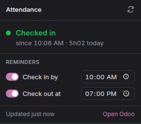

# Odoo Attendance Monitor

Chrome extension (Manifest V3) that shows whether you are checked in on
www.odoo.com and reminds you to check in and out.



- **Toolbar icon**: an Odoo-style "O" ring, green (checked in) or red (checked
  out); grey when unknown / signed out
- **Tab favicon**: the Odoo "O" in open Odoo tabs turns green or red; a small
  toast appears when the state changes
- **Popup**: current state, time since check-in, hours today, reminder settings
- **Reminders**: desktop notification at the check-in time if you are not
  checked in, and at the check-out time if you are still checked in.
  *Open Odoo* or *Snooze 5 min*. A reminder whose alarm fires more than 3 hours
  late (computer asleep) is skipped.

## Install

1. `chrome://extensions` → enable **Developer mode**
2. **Load unpacked** → select this folder

## How it gets the attendance

Every minute the service worker calls `/hr_attendance/attendance_user_data`
(a read-only route; the extension never checks you in or out). Chrome attaches
your www.odoo.com session itself because of the host permission; the extension
never reads your cookies. Every open Odoo tab also polls the same route
(same-origin) every minute and reports back; whichever works keeps the state
fresh. No request goes anywhere other than www.odoo.com.

## Permissions

| Permission | Why |
|---|---|
| `alarms` | Polling and reminder times |
| `notifications` | Reminders |
| `storage` | State and reminder settings |
| `https://www.odoo.com/*` | Call the attendance route (Chrome sends your session cookie; the extension can't read it), update the Odoo tab favicon |

## Tests

```bash
node --test tests/test_attendance.js
```
